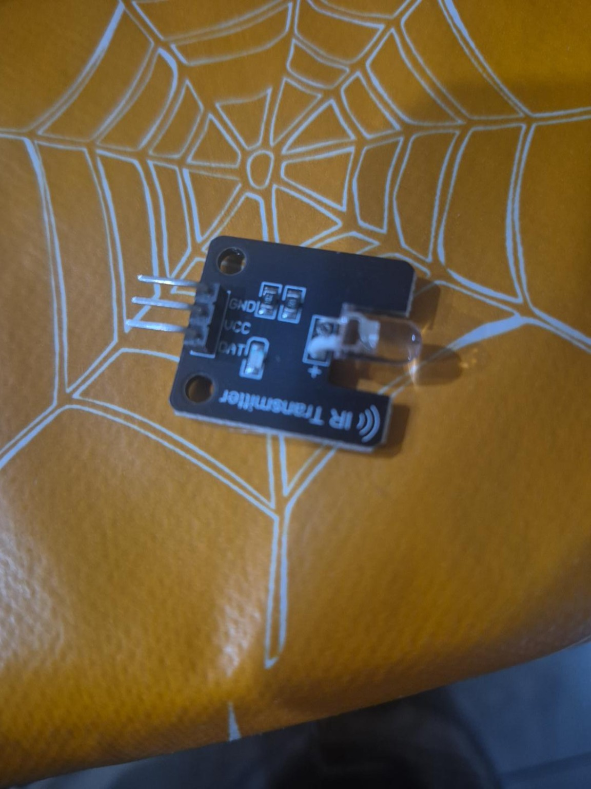
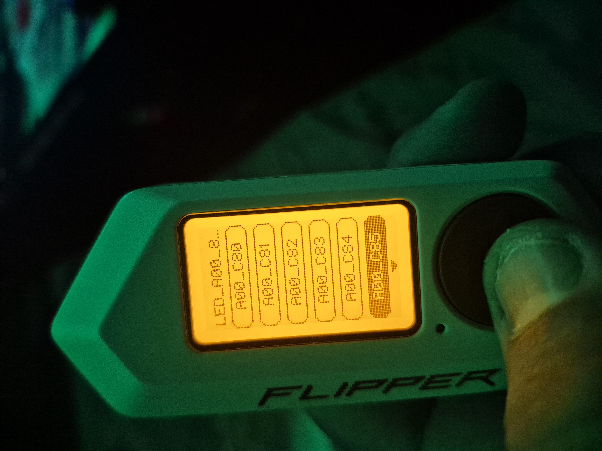
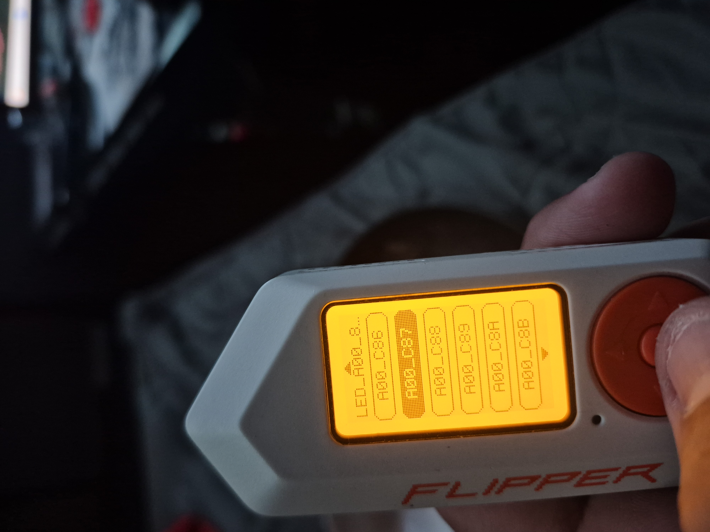
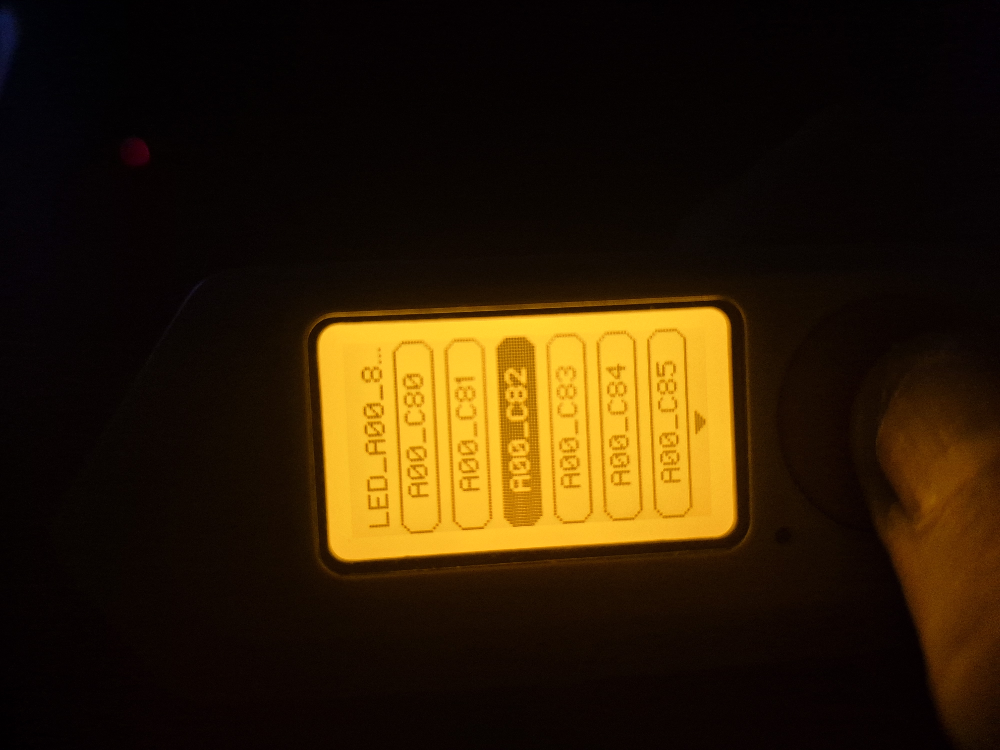
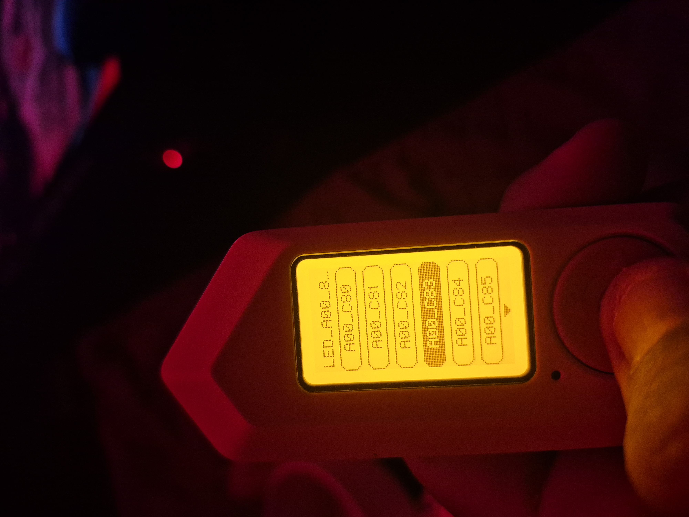
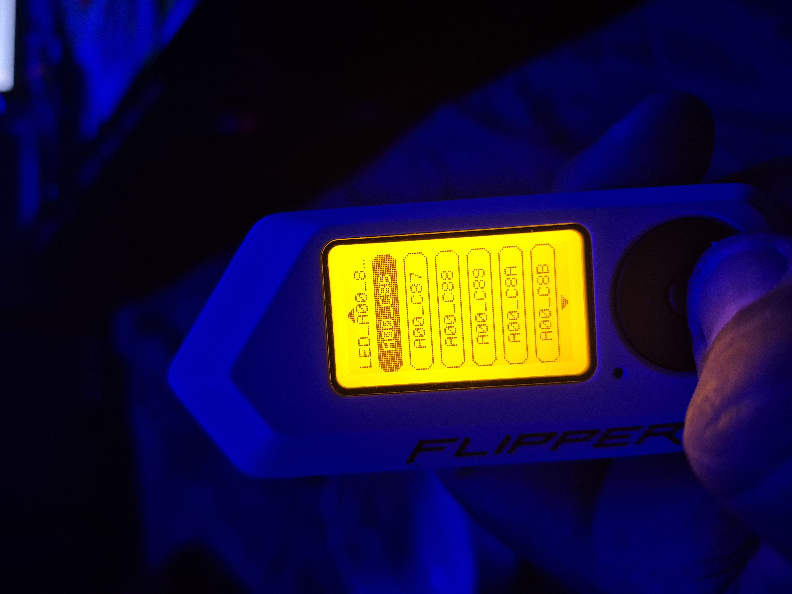
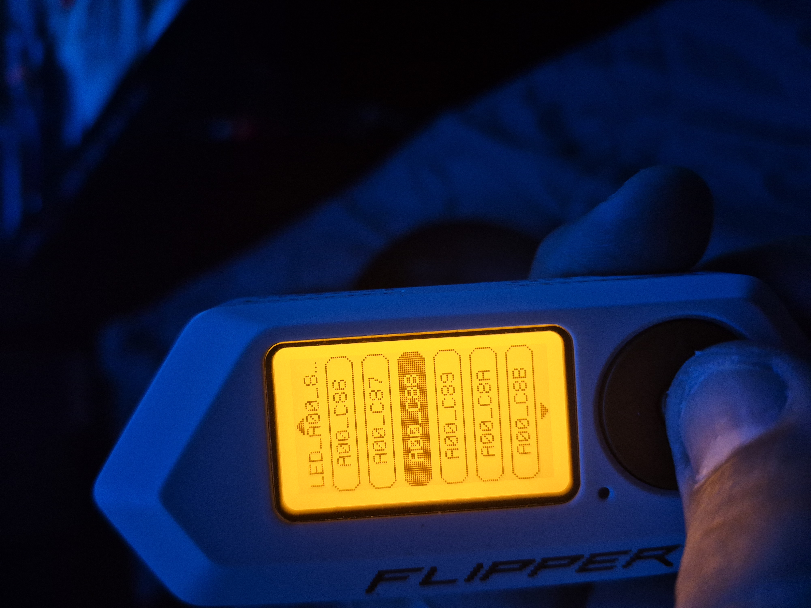

# The Kids Lost the LED Remote, So We Built One with an ESP32

*A small family electronics project that turned into a Wi-Fi IR controller with saved commands and over-the-air updates.*

**GitHub repository:** [https://github.com/TechTucson/LED_FAM_ESP32]

## It started with a missing remote

A while back, the kids lost the remote for our LED lights. The lights still worked, but changing colors or turning them off wasn't exactly convenient without the remote.

I had an ESP32 on hand and figured this would be a good excuse to put it to work. The original goal was simple: send the same infrared commands as the missing remote. As usual, once I got into it, I started thinking about what else we could do. Why stop at replacing a remote when the ESP32 could host a little web page and let us control the lights from a phone?

The kids helped with the hands-on part of the build, especially connecting the wires. They haven't done the Arduino programming yet, but they were involved in getting the hardware together. That was a fun part of the project: turning a missing remote into an opportunity to build something together.

## The parts

This wasn't a complicated build. I used:

- An **ESP32 development board**
- A **three-pin IR transmitter module** (the one I used is rated for 5V)
- Jumper wires and a USB power cable
- A **Flipper Zero** to test and verify the IR commands
- Arduino IDE with the **IRremoteESP8266** library



*The three-pin IR transmitter module. The board labels its connections GND, VCC, and DAT.*

### Wiring

| IR transmitter | ESP32 |
| --- | --- |
| GND | GND |
| VCC | 5V/VIN (for this 5V-rated module) |
| DAT | GPIO 26 |

The ESP32's onboard **BOOT button (GPIO 0)** also serves as a physical control. A short press cycles through commands; a long press sends OFF. Check your own module's voltage and signal requirements before wiring it the same way.

## Finding the IR commands

I didn't have the original remote to learn from, so I used my Flipper Zero to test a range of NEC infrared commands against the LED controller. I generated a Flipper-compatible `.ir` file, tried the codes, and kept track of the ones that actually did something.



*Testing NEC codes with the Flipper Zero while watching how the LEDs responded.*

The working set used NEC address `0x00`. Two commands are confirmed by function:

| Flipper command | Function |
| --- | --- |
| `A00_C82` | OFF |
| `A00_C83` | Working command; function still to label |
| `A00_C85` | GREEN |
| `A00_C86` | Working command; function still to label |
| `A00_C88` | Working command; function still to label |
| `A00_C89` | Working command; function still to label |



*One of the tests that helped identify the working commands.*

## The part that took longer than expected

Getting the ESP32 to print a command in Serial Monitor was easy. Getting the LED controller to respond was another story.

At first, nothing happened. I tried checking the IR transmitter with a phone camera, changing the module's power from 3.3V to its specified 5V, and testing the GPIO output. The module's red indicator blinked, so the ESP32 was definitely controlling the signal pin. Eventually, the Flipper Zero picked up transmissions from the ESP32 from several feet away. That confirmed we were sending *something*.

The important distinction was that a valid NEC transmission wasn't necessarily the *right* NEC transmission. The address and command values were being interpreted differently because of NEC bit ordering and how the 32-bit frame was assembled.

The breakthrough was getting the ESP32 to transmit a frame that the Flipper decoded as **address `0x00`, command `0x85`**—and then getting the LED controller to respond. The working frame for green was:

```cpp
irsend.sendNEC(0x00FFA15E, 32);
```

That was the first satisfying moment: the LED controller finally responded to the ESP32. From there, the same encoding approach could be applied to the other commands.

## From a replacement remote to a web controller

Once the basic IR transmission worked, I wanted to make it more useful than the original remote. The ESP32 now has a sketch designed to connect to Wi-Fi and serve a small control page, so the commands can be sent from a phone or computer on the local network.

The project also includes these features in the latest firmware:

- **Web-based IR controls** for the known NEC commands
- **Non-volatile storage (NVS)** so commands can be added, renamed, and saved across restarts
- **A management page** for editing the command list without recompiling firmware
- **Browser-based OTA updates** for uploading new compiled firmware over Wi-Fi
- **Serial diagnostics** for the Wi-Fi MAC address, connection status, IP address, and signal strength
- **Physical BOOT-button control**, including a long press for OFF

The firmware features are implemented in the current sketch; the original IR transmission was tested successfully, while the full web/NVS/OTA workflow should be validated on your own board and network.

### What the web interface does

Once connected to Wi-Fi, the ESP32 prints its IP address in Serial Monitor at **115200 baud**. Opening that IP address in a browser brings up the IR controls. The firmware also provides management and update pages:

| Path | Purpose |
| --- | --- |
| `/` | LED control buttons |
| `/manage` | Add, rename, or remove IR commands |
| `/update` | Upload an OTA firmware `.bin` |
| `/status` | Device and Wi-Fi diagnostics |

The web interface is intended for a trusted local network. It uses password protection, but HTTP Basic authentication is not encrypted; I wouldn't expose it directly to the internet.

## Getting it running

1. Wire the IR transmitter to the ESP32 as shown above.
2. Install the **ESP32 board package** and **IRremoteESP8266** library in Arduino IDE.
3. Open the project `.ino` sketch and set your Wi-Fi SSID, password, and web login credentials.
4. Choose an ESP32 partition scheme that supports OTA updates.
5. Upload the sketch over USB the first time.
6. Open Serial Monitor at **115200 baud** to find the Wi-Fi MAC address, connection status, and assigned IP address.
7. Open the ESP32's IP address from a device on the same network.

After that, the plan is to manage new NEC codes from the browser and use `/update` for firmware changes. OTA firmware uploads require an exported compiled `.bin` and a compatible partition layout.

**Firmware:** [See the Arduino sketch in this repository](ESP32_WiFi_IR_NVS_OTA.ino)

## Photos from the testing

These are some of the actual Flipper Zero tests along the way, rather than polished project photos.

| | |
| --- | --- |
|  |  |
|  |  |

## What I'd like to add next

I'd like to finish identifying the remaining color and effect commands, give every button a meaningful label, and possibly make the interface a little nicer. Longer term, it could be useful to support multiple LED controllers or other IR devices from the same ESP32.

The kids haven't started programming it yet, but that could be the next part of the project. They've already helped connect the wires, and now there's something tangible to experiment with: press a button on a web page, send an IR command, and watch the lights change.

For a project that started because we couldn't find a remote, that's a pretty good outcome.

---

**GitHub repository:** [https://github.com/TechTucson/LED_FAM_ESP32]

**Project status:** IR transmission confirmed working; Wi-Fi/NVS/OTA firmware prepared for further testing.
